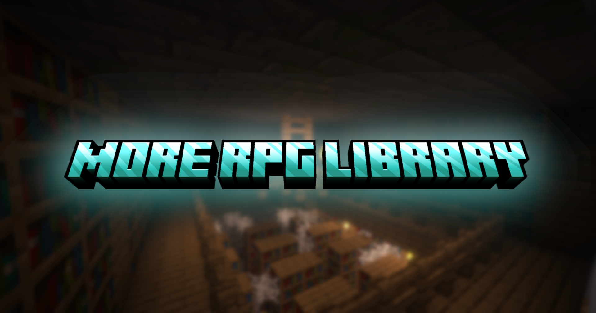

    

#  Welcome to the More RPG Library Wiki!

A general-purpose library for all my RPG content mods: new entity attributes, status effects, weapon skills, mob AI goals, mob animations, an entity attribute config system and more.
Feel free to use it as a dependency for your own mod!

The library also brings new animations (played through playerAnimator), sound effects and particle effects that the content mods share.

## Optional mods

Nothing is required except the library itself.
[Spell Engine](https://github.com/ZsoltMolnarrr/SpellEngine), Spell Power, [playerAnimator](https://modrinth.com/mod/playeranimator), [Better Combat](https://modrinth.com/mod/better-combat), [Combat Roll](https://modrinth.com/mod/combat-roll), Runes, Ranged Weapon API and Critical Strike are all optional.
Install one and the matching parts light up, everything else keeps working without it.
Each page says when it needs one of them.

## For players and modpack makers

- [Spell Schools](Spell-Schools): Air, Earth, Water and Nature magic, Fire and Frost ranged, Rage melee and the Dynamic school.
- [Entity Attributes](Entity-Attributes): Lifesteal, Damage Reflect, Rage, Fuse, Tenacity, Armor Piercing and the on-hit chance attributes.
- [Status Effects](Status-Effects): every harmful and beneficial effect with its numbers.
- [Weapon Skills](Weapon-Skills): Burstcrack, Decapitate and Puncture.

## For datapack makers

- [Custom Spell Impacts](Custom-Spell-Impacts)
- [Loot Table Enhancements](Loot-Table-Enhancements)
- [Structure Processors](Structure-Processors)
- [Structure Block Modifiers](Structure-Block-Modifiers)

## For mod developers

- [Mob Spell Casting](Mob-Spell-Casting)
- [Spellcaster Flee and Positioning Goals](Spellcaster-Flee-and-Positioning-Goals)
- [Mob Animations (playerAnimator bridge)](Mob-Animations)
- [Better Combat and Combat Roll for Mobs](Better-Combat-and-Combat-Roll-for-Mobs)
- [Entity Attribute Config](Entity-Attribute-Config)
- [Particle FX (MRPG FX)](Particle-FX)
