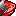

# Weapon Skills

Melee weapon skills in the `mrpg_lib` namespace, ready to be assigned to any weapon through a Spell Engine spell container.
They live in this library so several content mods can share them without depending on each other.
Needs Spell Engine.

All three use the shared `weapon` cooldown group.

| Icon | Skill | ID | Description |
|---|---|---|---|
|  | Burstcrack | `mrpg_lib:burstcrack` | Charged (up to 1.5 s) — release a shockwave around you that hits every enemy nearby for 50% of your attack damage and knocks them up (bosses are not knocked up). The longer you charge, the further it reaches (5.5 blocks, up to +3 at full charge) and the harder it hits. You move at 25% speed while charging. Cooldown: 15 s. *Typically assigned to: knuckles (Forcemaster).* |
|  | Decapitate | `mrpg_lib:decapitate` | Cast (0.75 s) — a heavy 180° swing with forward momentum, dealing 25% bonus damage. Disables the target's shield and stops its item use for 2 seconds. Cooldown: 15 s. *Typically assigned to: berserker axes (Berserker).* |
|  | Puncture | `mrpg_lib:puncture` | Cast (0.7 s) — dash forward in a series of 6 quick thrusts with 20% bonus damage each, striking every enemy along your path once. Can't be used in the air. Cooldown: 10 s. *Typically assigned to: rapiers (Bards).* |
